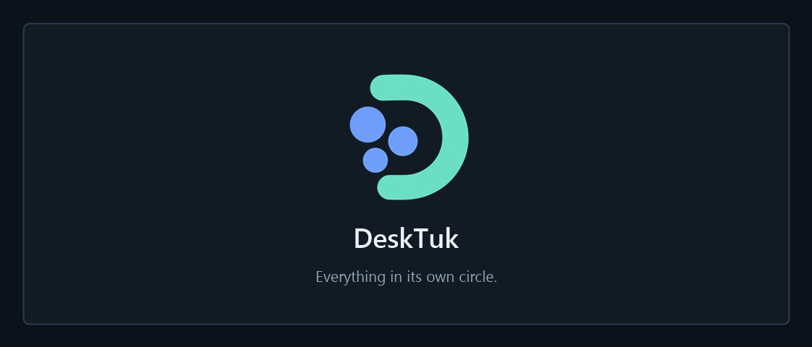
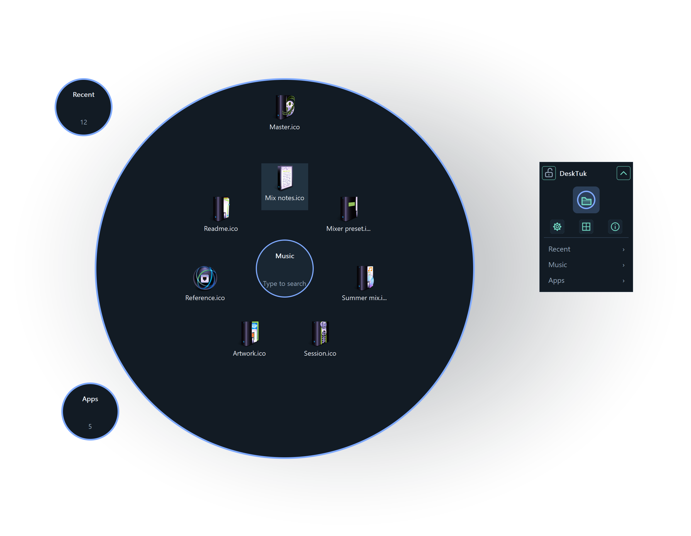
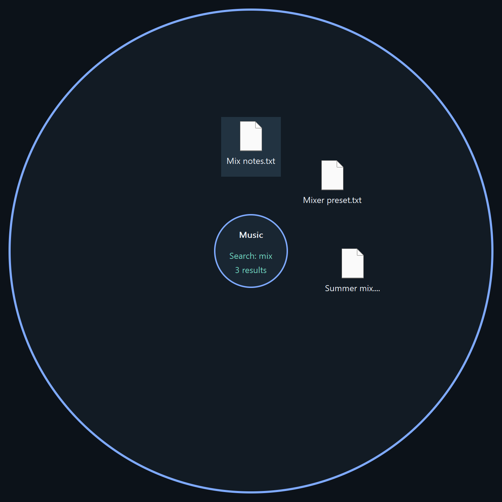

<p align="center">
  
</p>

<p align="center">
  <b>A little more room on your Windows desktop.</b><br>
  Gather files and shortcuts into circles. Hover to browse, type to find, click to open.<br>
  Your files stay where they are.
</p>

<p align="center">
  
  
  
  <a href="LICENSE"></a>
</p>

<p align="center">
  <a href="#get-desktuk">Get DeskTuk</a> ·
  <a href="#make-yourself-at-home">Quick start</a> ·
  <a href="#find-it-without-the-hunt">Search</a> ·
  <a href="docs/user-guide.md">Türkçe / English guide</a> ·
  <a href="#building-from-source">Build</a>
</p>

<p align="center">
  <a href="https://raw.githubusercontent.com/ege-ozel/desktuk/main/docs/media/desktop-overview.png"></a>
  <br><sub>Native DeskTuk rendering with example ICO files; not a live desktop capture. Icons: <a href="https://wallpaperfx.com/">WallpaperFX</a>, <a href="https://creativecommons.org/licenses/by/4.0/">CC BY 4.0</a> (<a href="docs/media/icons/README.md">credits</a>).</sub>
</p>

<table>
  <tr>
    <td width="50%" valign="top"><b>Everything has a circle</b><br>Make circles for music, work or apps. Add groups inside them. Recent gathers Desktop entries you haven't assigned yet.</td>
    <td width="50%" valign="top"><b>Find it as you type</b><br>Search an open circle or a panel file list. Names starting with your query come first, followed by names containing it.</td>
  </tr>
  <tr>
    <td valign="top"><b>A layout that stays yours</b><br>Move circles freely or snap them to a grid. The small panel slides along any screen edge, including corners.</td>
    <td valign="top"><b>Native, from the start</b><br>Windows file icons, shell context menus and default apps. Written in Rust with Win32; no browser engine or GUI framework.</td>
  </tr>
</table>

## Get DeskTuk

DeskTuk **0.1.0 is a release candidate**. Published installers will be listed on the
[Releases page](https://github.com/ege-ozel/desktuk/releases). Until then, build from source below.

The Windows x64 installer is named `DeskTuk-<version>-Setup-x64.exe`. It installs for
your Windows account without an administrator prompt. The installer is currently unsigned.
Packaging details, including update and uninstall behavior, are in the
[installer guide](installer/README.md).

The interface supports **English and Turkish**. Choose **Settings → Language**;
your circle names and filenames keep their original text.

## Make yourself at home

1. **Create a circle.** Right-click a circle or the panel and choose **New circle**.
2. **Add your files.** Drop files or shortcuts from Explorer onto it. DeskTuk stores references to their paths.
3. **Hover to look inside.** Click a file icon to open it in its usual app. Scroll to browse more items.
4. **Arrange your space.** Drag a circle by its centre or empty background with the left mouse button. Drag a blank panel area to move the panel along the screen edges.

Right-click a file for its Windows shell menu. Moving a reference between DeskTuk
circles changes its organization inside DeskTuk; it does not relocate the original file.
Actions you choose in a Windows shell menu still act on the real file.

| Control | What it does |
| --- | --- |
| Lock | Stops circles opening on hover and disables the panel's show/hide tile; panel file search and dragging remain available. |
| Centre tile | Shows or hides circles when unlocked. |
| Top-right arrow | Collapses or expands the panel immediately. |
| Settings | Chooses the language and turns usage tips on or off. |
| Grid | Chooses Off, 2×2, 3×3, 4×4, 6×6 or 8×8. **Align now** arranges existing circles. |
| Info | Opens the short guide. Clicking again brings the same guide forward. |
| Circle rows | Opens a searchable file list, including while locked. |

Grid selection keeps the current layout in place; it snaps subsequent drag releases.
**Align now** is a separate action. New installations start at 4×4.

## Find it without the hunt

**On a circle:** hover to open it and start typing, even one letter. A native text
field appears. **The first result is highlighted**, including before you type.
Up/Down moves the selection; Enter opens the highlighted item. Moving over a file
highlights that file instead. Escape clears the search; closing the circle resets it.

**From the panel:** click a circle name and type in the field above its file list.
The first result is selected as the list opens and whenever the query changes.
Down selects the next result. Single-click selects; double-click or Enter opens.
The list has one continuous scrollbar. Escape closes it.

Both search fields support familiar editing: **Ctrl+A**, **Ctrl+C/X/V/Z**,
**Shift+arrows**, Home/End and selection with the mouse.

<p align="center">
  <a href="https://raw.githubusercontent.com/ege-ozel/desktuk/main/docs/media/search-results.png"></a>
  <br><sub>Native search rendering with example ICO files. Prefix matches come first. Icons: <a href="https://wallpaperfx.com/">WallpaperFX</a>, <a href="https://creativecommons.org/licenses/by/4.0/">CC BY 4.0</a>.</sub>
</p>

## Small details, everyday use

- **Keep the panel nearby.** Expanded or compact, it stays on a screen edge. Its position is saved.
- **Get an explanation.** Usage tips describe controls, explain locked actions and point out draggable space. Toggle them in Settings or the panel's right-click menu.
- **Keep access in the tray.** Use the notification-area icon to show DeskTuk again. Windows startup is opt-in from its menu.
- **Choose your desktop.** **Show desktop icons** controls Explorer's own icons independently of DeskTuk circles.
- **Keep your layout.** Settings and references live in `%APPDATA%\DeskTuk\desktuk.cfg`. Uninstall leaves this configuration and your referenced files intact.

## Lightweight by design

DeskTuk uses native Windows windows and drawing. Search filters existing reference
snapshots; it does not crawl your drives. Panel file lists draw visible rows rather
than rendering every filename at once. Shell icon work is coalesced, and the typing
hook is temporary, scoped to an open circle/editor rather than active at idle.

There is no Electron, Tauri, WebView or bundled font. Current release performance
numbers have not been remeasured; the [release review](docs/superpowers/reviews/2026-10-23-release-readiness.md)
separates checked behavior from remaining validation.

## Building from source

Use **Windows x64**, the Rust MSVC toolchain, Visual Studio C++ Build Tools and the
Windows SDK. In an x64 developer shell:

```powershell
cargo build --release --locked
.\target\release\DeskTuk.exe
```

To build the installer with Inno Setup, follow [installer/README.md](installer/README.md).
It does not require Rust or Inno Setup on the destination PC.

<details>
<summary><b>Development checks and code map</b></summary>

```powershell
cargo fmt --check
cargo clippy --release --locked -- -D warnings
cargo test --release --locked
```

Build and test Windows code with MSVC on Windows. These commands are contributor
instructions, not a claim that all checks have run against the latest candidate.
Final automated regressions and clean install/upgrade/uninstall validation remain
pending. The [release review](docs/superpowers/reviews/2026-10-23-release-readiness.md)
covers the preceding candidate; the first-result selection change is recorded in
[Plan D, D57](docs/superpowers/plans/2026-10-13-phase2-d-circles.md#d57-readme-presentation-and-visible-first-result-selection).
Physical integration scripts move the pointer and may create Desktop fixtures;
read their instructions and use a supervised test environment.

| Area | Source |
| --- | --- |
| Circles, hover, search, grid and reference model | `src/circles/` |
| Panel and edge dragging | `src/dock.rs`, `src/dock_drag.rs` |
| Windows shell and file launch | `src/items.rs`, `src/shell_menu.rs` |
| Settings, language and tips | `src/settings.rs`, `src/i18n.rs`, `src/hint.rs` |
| Persistence and startup | `src/config.rs`, `src/autostart.rs`, `src/tray.rs` |
| Packaging | `installer/`, `scripts/build-installer.ps1` |

The earlier Node panel remains available with `DeskTuk.exe --ui panel`.
Contributors and coding agents start with [AGENTS.md](AGENTS.md) and the
[repository context](docs/superpowers/plans/CONTEXT.md).

</details>

## License

DeskTuk is released under the [MIT License](LICENSE). README example icons are
3D BlueFX Desktop by [WallpaperFX](https://wallpaperfx.com/), licensed separately
under [CC BY 4.0](https://creativecommons.org/licenses/by/4.0/); see [credits and sources](docs/media/icons/README.md).
